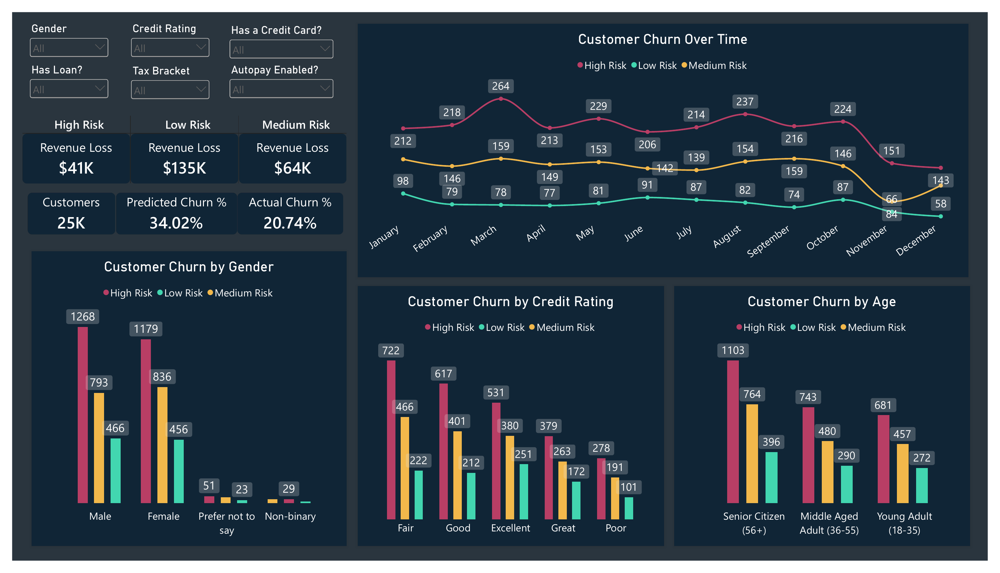

# Customer Churn Prediction & Retention Analytics

## Project Overview

This project uses machine learning to predict customer churn and identify customers who may be at risk of discontinuing their services.

Using Python and predictive modeling, I developed a classification model that estimates the probability of individual customers churning. These predictions are then transformed into customer risk categories and integrated into an interactive Power BI dashboard.

The objective is to move beyond historical churn reporting and develop a proactive approach to customer retention by identifying potential churn before it happens.

**Project Workflow:**

Python & Data Analysis → Machine Learning → Probability Predictions → Power BI

---

## Business Problem

Customer churn is a major challenge for businesses because losing existing customers can negatively impact recurring revenue, customer lifetime value, and long-term profitability.

Traditional reporting focuses on customers who have already churned. This project explores how predictive analytics can help businesses identify customers with a higher probability of leaving.

**Key Business Questions:**

- Which customers are most likely to churn?
- What customer characteristics are associated with higher churn probabilities?
- Which customer segments present the greatest retention risk?
- How can businesses prioritize customers for retention campaigns?
- How can predictive probabilities be translated into actionable business insights?

---

## Technologies & Skills

| Category | Technologies / Skills |
|---|---|
| Programming | Python |
| Data Manipulation | Pandas, NumPy |
| Data Analysis | Exploratory Data Analysis (EDA), Statistical Analysis |
| Machine Learning | Scikit-learn, XGBoost |
| Predictive Modeling | Classification, Probability Estimation, Feature Engineering |
| Model Evaluation | ROC-AUC, Accuracy, Balanced Accuracy, Brier Score |
| Business Intelligence | Microsoft Power BI |
| Data Preparation

### Key Skills Demonstrated

- Data cleaning and preprocessing
- Exploratory data analysis
- Categorical feature encoding
- Feature selection and engineering
- Supervised machine learning
- Customer-level churn probability estimation
- Model performance evaluation
- Classification threshold optimization
- Customer risk segmentation
- Business intelligence and dashboard development
- Translating machine learning outputs into business recommendations

---

## 1. Data Preparation & Exploratory Data Analysis

The first stage involved preparing the customer dataset for analysis and predictive modeling.

Tasks included:
- Inspecting dataset structure and data types.
- Identifying missing values and potential inconsistencies.
- Preparing categorical and numerical variables.
- Exploring customer characteristics and churn patterns.
- Identifying potential relationships between customer attributes and churn.

**Exploratory Data Analysis**

**Data Preparation Code**

---

## 2. Machine Learning & Predictive Modeling

After preparing the data, I developed classification models to estimate customer churn probabilities.

The project explored machine learning approaches, including:

- Logistic Regression
- Random Forest
- XGBoost Classifier

The models were evaluated using multiple performance metrics to assess predictive accuracy, classification performance, and probability calibration.

### Model Evaluation

Rather than relying exclusively on accuracy, I incorporated additional evaluation metrics to better understand model performance.

| Metric | Purpose |
|---|---|
| Accuracy | Measures the percentage of correct predictions. |
| ROC-AUC | Measures how effectively the model distinguishes between customers who churn and those who remain. |
| Balanced Accuracy | Accounts for performance across both churn and non-churn classes. |
| Brier Score | Measures the accuracy of predicted probabilities, with lower scores indicating better calibration. |

**Model Performance**

**Model Development**

---

## 3. Churn Probability & Customer Risk Classification

One of the primary objectives of this project was to generate individual churn probabilities rather than simply classifying customers as churn or non-churn.

The model produces a probability score for each customer, allowing businesses to prioritize retention efforts based on predicted risk.

These probabilities are translated into risk categories using configurable thresholds.

**Example Risk Classification:**

| Risk Category | Probability |
|---|---|
| Low Risk | Below 60% |
| Moderate Risk | 60%–79.99% |
| High Risk | 80% and above |

*Risk thresholds are configurable and can be adjusted based on business objectives and retention capacity.*

This approach allows businesses to identify customers who may require immediate attention while avoiding a one-size-fits-all retention strategy.

**Customer Probability Predictions**

---

## 4. Power BI Dashboard & Business Intelligence

The final stage involved integrating the machine learning predictions into Microsoft Power BI to create an interactive customer churn analytics dashboard.

The dashboard translates model outputs into actionable business insights, allowing users to explore churn risk, identify customer segments, and prioritize retention opportunities.

### Dashboard Features

- **Customer Risk Overview:** High-level view of customers categorized by predicted churn risk.
- **Churn Probability Analysis:** Distribution of predicted churn probabilities.
- **Customer Segmentation:** Explore churn risk across different customer characteristics.
- **Retention Prioritization:** Identify customers with elevated probabilities of churning.
- **Interactive Filtering:** Explore customer populations and risk categories through dashboard filters.

### Power BI Dashboard Preview

## 5. Business Applications & Recommendations

The predictions generated by this project can support several customer retention strategies.

**Proactive Retention Campaigns**

Identify customers with elevated churn probabilities and prioritize them for retention outreach.

**Customer Segmentation**

Determine which customer groups demonstrate higher churn risk and investigate potential causes.

**Resource Allocation**

Help retention teams prioritize their time and resources toward customers who may be more likely to leave.

**Revenue Protection**

Use customer risk information alongside customer value and recurring revenue data to help prioritize retention opportunities.

---

## Project Takeaways

This project demonstrates how machine learning can extend traditional business intelligence beyond historical reporting.

By combining predictive modeling with Power BI, businesses can transition from understanding which customers have already churned to identifying which customers may churn in the future.

The project showcases an end-to-end predictive analytics workflow, combining data preparation, machine learning, probability estimation, model evaluation, and interactive business intelligence.

---

## Jehlyen Fuller | Data Analyst

**Machine Learning & Data Analytics Portfolio Project**

Developed to demonstrate practical applications of predictive analytics, supervised machine learning, and business intelligence.

**Technologies:** Python | Pandas | Scikit-learn | XGBoost | Power BI
